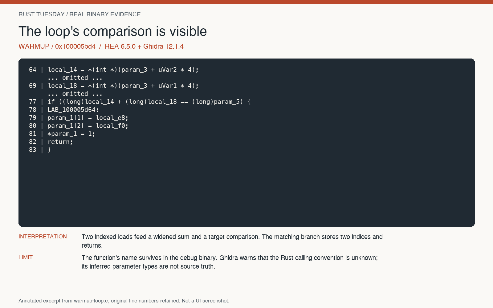
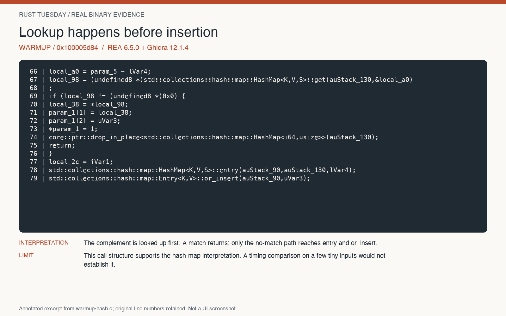
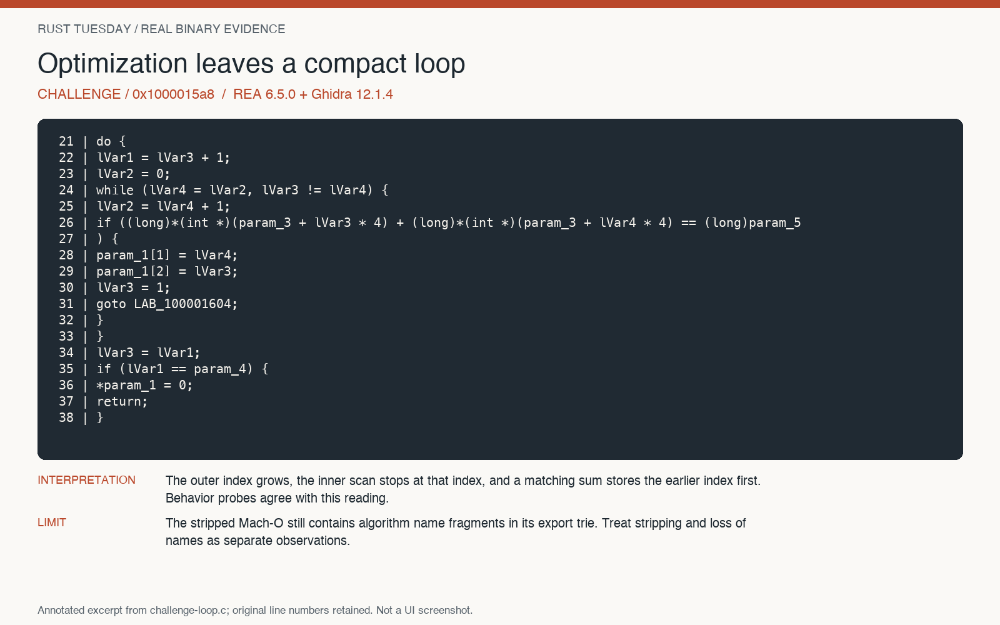

# Native analysis rehearsal: completed

Recorded 15 October 2026 on macOS 26.6.2 ARM64. REA 6.5.0, Ghidra 12.1.4,
Node 24.12.0, OpenJDK 21.0.9. Ghidra's ARM64 decompiler was built locally using
Apple clang 21. The archive's SHA-256 matched the official release digest.

This is a technical rehearsal by an author who had seen the reference source.
It is **not** an independent blind reconstruction or a timed session with learners.

## Artifact identity

| Binary | SHA-256 |
| --- | --- |
| Warmup | `d7ede7290fc4c35a69aab4f3945cae43e8c51a20e0e1d6dc4e33ca9bdb2e1297` |
| Challenge | `c13981d9bec980d21e1be9b8706eaf0ee5476b2697e23575a45c79f44f20adca` |

Addresses below apply to those exact binaries. A rebuild on another toolchain
can move everything. Rediscover addresses from the inventory and references.

## A route that actually worked

1. `analyze` imported the warmup in **18.434 seconds**; Ghidra reported 1,014
   procedures. Challenge import took **14.524 seconds**, with 754 procedures.
2. A procedure search for `find` located the warmup loop at `0x100005bd4` and
   hash implementation at `0x100005d84`.
3. The loop dossier supplied pseudocode, instructions and an incoming call from
   `rust_tuesday::solve` at `0x1000028b0` (call site `0x1000028d4`). Decompiling
   that caller confirmed a direct call to the concrete loop implementation.
4. In the challenge, a string search for `usage:` returned `0x10003b370`, with
   the partial defined string `usage: pair-find`. Its references were
   `0x100000eb0` and `0x100000fa0`.
5. Asking for the function containing `0x100000eb0` reached `FUN_100000e20`.
   Its body checks mode bytes `0x61`/`0x62` and calls the loop at `0x1000015a8`
   or hash implementation at `0x10000160c`.
6. The optimized loop is a compact, readable comparison. The hash implementation
   expands into 348 lines of pseudocode including hashing and table probes.
   Teach the loop in the core segment; use the hash internals as an extension.

Every successful native command took 14.5-18.5 seconds in this run, including
fresh import, query and cleanup. Some ran concurrently, so this is not a benchmark
or a promise for another laptop. Exact commands and durations: [timings.json](timings.json).

## Projector-ready excerpts

These are annotated renderings of actual captured pseudocode, **not screenshots
of the Ghidra UI**. Source line numbers refer to the `.c` review files beside them.

[Full loop pseudocode](warmup-loop.c) · [dossier review copy](warmup-loop.json) ·
[caller pseudocode](warmup-caller.c)

[Full hash pseudocode](warmup-hash.c) · [provider output](warmup-hash.json)

[Full optimized loop](challenge-loop.c) · [challenge CLI](challenge-main.c) ·
[optimized hash implementation](challenge-hash.c)

## The stripping surprise

`nm` reported 72 entries and no local symbols in the challenge. However, the
Mach-O `LC_DYLD_INFO_ONLY` export trie occupies file bytes `[329664, 348192)`.
The bytes `BruteForce` occur at 344651 and `HashLookup` at 344729, inside that
range. Ghidra recovered the corresponding function names from the binary.

This challenge is optimized and stripped according to the Cargo profile. It is
**not anonymous**. Do not score a learner for "recovering" names that remain in
the artifact. [Retained export observations](retained-exports.json)

## Behavioral reconstruction

[23 recorded probes](behavior.json) cover matches, absence, duplicates, negatives,
ties, integer boundaries and invalid inputs. The alternate implementation in
`reconstruction/main.rs` uses a loop for both modes and passed all **225**
comparisons against the stripped original. [Actual comparison output](comparison.txt)

This supports agreement for those cases. It does not establish all inputs,
identical source, identical instructions or equivalent performance. In particular,
the replacement for mode `b` does not preserve the original's expected O(n) search.

## Limits and provenance

- Ghidra warns `Unknown calling convention: __rustcall` on search functions and
  `Type propagation algorithm not settling` on the challenge CLI. Treat inferred
  types and signatures cautiously; use instructions and behavior to check claims.
- The JSON files are selected **review copies**. Dossiers omit repetitive stack
  references. Local paths and home-derived labels are redacted; `.c` display files
  also trim trailing whitespace without changing source line numbers. Each copy records
  the SHA-256 of the original local capture and its REA evidence ID. These copies
  are not canonical bundles for `rea evidence-import`.
- Raw outputs, stderr, timing receipts and build logs remain in `tmp/rea-live/`
  on the prepared machine. `scripts/curate-evidence.py` rebuilds the review copies;
  `scripts/render-evidence.py` rebuilds the three image excerpts.
- No human learner rehearsal, Linux run, Intel Mac run or native Windows run was
  performed. No agent MCP registration was installed; the verified route is CLI.

## Repeat locally

Use [local tool setup](../LOCAL-TOOLS.md), then the exact commands in
[timings.json](timings.json), replacing `<WORKSHOP>` with the checkout path.
Run `python3 scripts/capture-rea.py NEW-LABEL ...` to preserve a fresh receipt.
